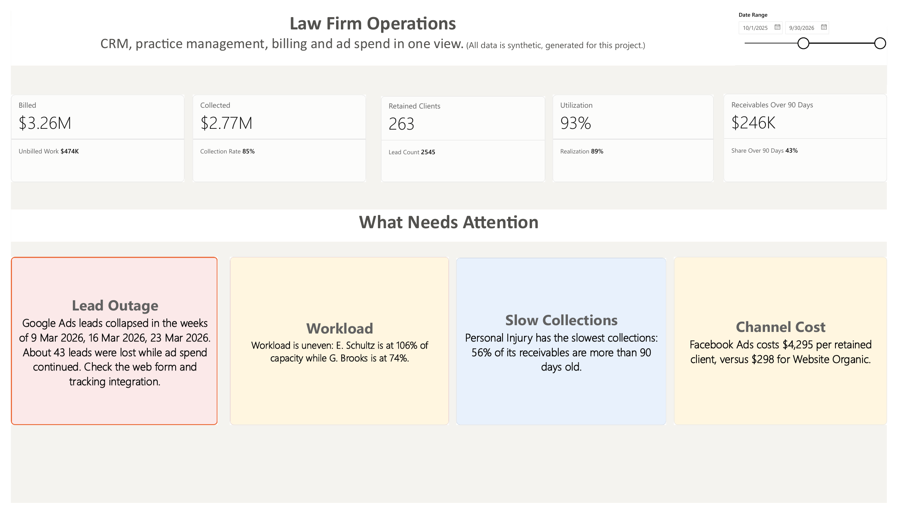
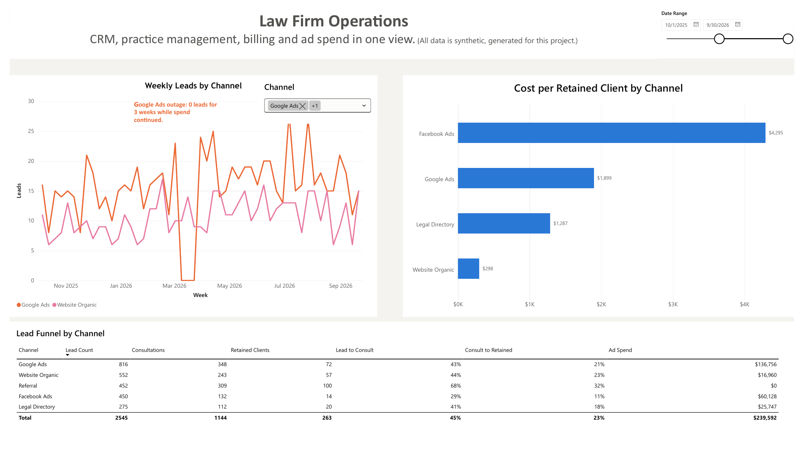
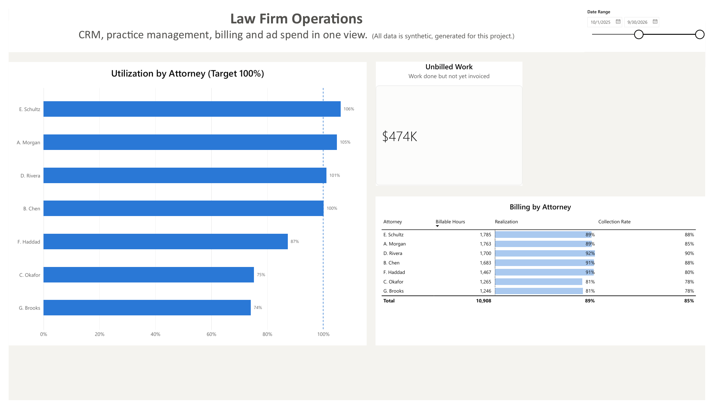
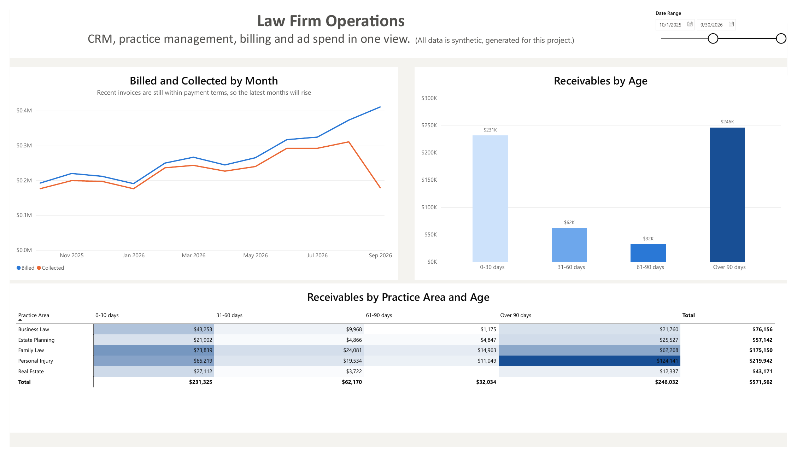
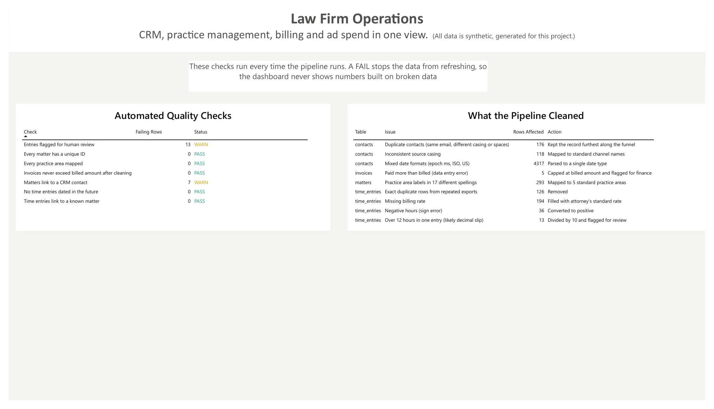

# Law Firm Operations Pipeline

An end to end data pipeline and dashboard that gives a small law firm one source of truth across its CRM, practice management, billing and advertising data.

I built every layer myself: extraction, cleaning, validation, SQL modelling, the Power BI data model and the dashboard.



The report has five pages: Overview, Intake & Marketing, Team, Revenue, and Data Quality. See the [full PDF export](docs/law_firm_ops.pdf), or the individual pages below.

| Intake & Marketing | Team |
| --- | --- |
|  |  |
| **Revenue** | **Data Quality** |
|  |  |

## The business problem

Small and mid sized firms run on disconnected tools. Leads live in the CRM, matters and time in the practice management system, invoices in billing, and ad spend in each ad platform. Leadership ends up asking questions nobody can answer quickly:

* Which marketing channels actually produce paying clients, and at what cost?
* Are our attorneys overloaded or underused?
* How much of our work do we actually bill, and how much of that do we collect?
* Did something break this week that we have not noticed yet?

## What the pipeline does

```
CRM export  ─┐
PM export   ─┼─> extract ─> clean ─> load staging ─> quality checks ─> SQL models ─> star schema ─> Power BI
Time export ─┤                                         (a FAIL stops the run)
Billing     ─┤
Ad spend    ─┘
```

| Step | File | What happens |
| --- | --- | --- |
| Extract | `pipeline/extract.py` | Paginated API calls with retry and rate limit handling (HubSpot and Clio style). Falls back to local exports so the project runs without credentials. |
| Clean | `pipeline/clean.py` | Parses three different date formats, merges duplicate contacts, maps 17 spellings of practice areas to 5, fixes sign errors and decimal slips in time entries, fills missing rates. Every fix is logged. |
| Validate | `pipeline/quality.py` | Seven automated checks. WARN results are shown to the user; a FAIL stops the dashboard from refreshing on broken data. |
| Model | `models/marts/*.sql` | dbt style SQL models in DuckDB: intake funnel and cost per retained client, attorney utilization, realization and collections, receivables aging, and weekly lead anomaly detection. |
| Export | `models/powerbi/*.sql` | Builds a star schema and exports it for Power BI: four dimension tables (Dates, Attorneys, LeadChannels, Matters) and four fact tables (Leads, TimeEntries, Invoices, AdSpend). |
| Visualise | `powerbi/` | Power BI report with DAX measures for utilization, realization, collections and cost per client, plus a "What needs attention" page that turns the numbers into plain language actions. See `powerbi/POWERBI_GUIDE.md`. |
| Prototype | `app.py` | A quick Streamlit version used to test the logic before building the Power BI report. |

## What the dashboard surfaced in the sample data

* **A broken lead source.** Google Ads leads dropped to zero for three weeks in March 2026 while spend continued. The anomaly check flagged it automatically; roughly 43 leads were lost.
* **A costly channel.** Facebook Ads cost about $4,300 per retained client, against about $300 for organic website leads.
* **Uneven workload.** One attorney was running above 100% of target utilization while another was near 74%.
* **Slow collections in one practice.** More than half of Personal Injury receivables were over 90 days old.

## Run it

```bash
pip install -r requirements.txt
python scripts/generate_sample_data.py   # creates messy sample exports in data/raw
python run_pipeline.py                   # builds the warehouse and data/powerbi/*.csv
```

Then open `powerbi/law_firm_ops.pbix` in Power BI Desktop and click **Refresh**. To run the Python prototype instead: `streamlit run app.py`.

To use real data, set `CRM_API_TOKEN` and `PM_API_TOKEN` and adjust the field mappings in `pipeline/clean.py`.

## Tech

Python (pandas, requests), SQL on DuckDB, Power BI (DAX, star schema), and a Streamlit prototype.

## A note on the data

All data is synthetic, generated by `scripts/generate_sample_data.py` to behave like real exports, including the problems real exports have. No client data is used.
